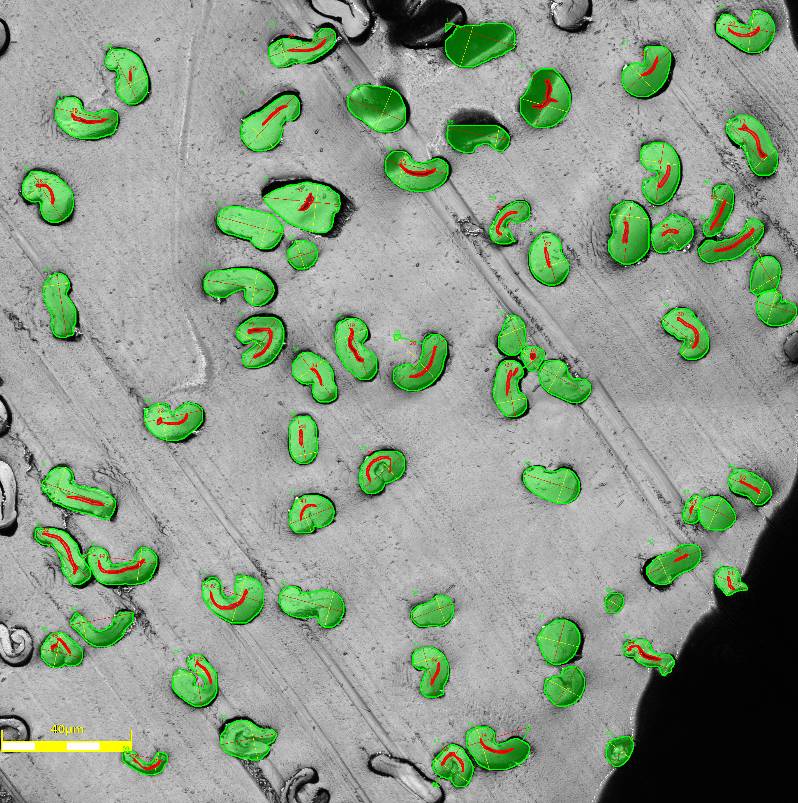

# cotton-lumen-micro

Scientific and developer workflow for segmenting cotton fibers and lumens from
microscopy images, measuring morphology, and exporting quantitative CSV results.

The project contains three Python entry points:

- `train.py`: trains a YOLO segmentation model for `cotton` and `lumen` masks.
- `analysis.py`: runs a trained YOLO segmentation model over microscopy images,
  pairs cotton objects with enclosed lumens, measures morphology, and writes CSV
  plus overlay images.
- `measure.py`: shared OpenCV measurement utilities plus a mask-only CLI for
  measuring contours from a binary or grayscale mask.

## Repository layout

```text
.
|-- analysis.py
|-- measure.py
|-- train.py
|-- cotton-lumen-micro.yaml
|-- requirements.txt
|-- data/
|   |-- images/train
|   |-- images/val
|   `-- images/test
|-- example/
|   `-- *.png
|-- example_output/
|   |-- fiber_measurements.csv
|   `-- overlays/
|       `-- *_overlay.png
`-- runs/segment/train33
    `-- results.csv
```

`cotton-lumen-micro.yaml` declares the YOLO dataset split paths and class map:

```yaml
train: data/images/train
val: data/images/val
test: data/images/test

names:
    0: cotton
    1: lumen
```

## Installation

Python 3.10 or newer is recommended.

### Windows PowerShell

```powershell
python -m venv .venv
.\.venv\Scripts\Activate.ps1
python -m pip install --upgrade pip
python -m pip install -r requirements.txt
```

### macOS/Linux

```bash
python -m venv .venv
source .venv/bin/activate
python -m pip install --upgrade pip
python -m pip install -r requirements.txt
```

For NVIDIA GPU training or inference, install the PyTorch build that matches
your CUDA runtime before installing `ultralytics`.

## Requirements

Direct Python dependencies are listed in `requirements.txt`:

```text
numpy
opencv-python
Pillow
ultralytics
```

`ultralytics` installs the YOLO runtime and its deep-learning dependencies.
`opencv-python` and `numpy` are used for contour extraction, geometry, and image
operations.

## Training

`train.py` trains a YOLO11 medium segmentation model using the local dataset
configuration.

```bash
python train.py
```

Current training settings in `train.py`:

| Setting | Value | Description |
| --- | --- | --- |
| Base model | `yolo11s-seg.yaml` | YOLO segmentation architecture used to initialize training. |
| Dataset | `cotton-lumen-micro.yaml` | Dataset split paths and class labels. |
| Batch | `-1` | Ultralytics auto-batch selection. |
| Epochs | `300` | Maximum training epochs. |
| Image size | `960` | Training image size in pixels. |

Typical Ultralytics outputs are written under `runs/segment/...`. The repository
also contains `train/results.csv`, an example training metric log with columns
such as `train/box_loss`, `train/seg_loss`, `metrics/mAP50(M)`, and validation
losses.

Example training CSV excerpt:

```csv
epoch,train/box_loss,train/seg_loss,train/cls_loss,train/dfl_loss,metrics/precision(B)
1,4.5663,11.298,4.0996,4.2333,0.00004
2,4.5809,6.8189,4.1051,4.2104,0.00001
```

## YOLO image analysis

Use `analysis.py` after training a segmentation model. It reads images from a
directory, performs sliding-window YOLO inference, filters and deduplicates
contours, pairs each cotton contour with the first lumen contour contained
inside it, then writes a measurement CSV.

```bash
python analysis.py \
  --model runs/segment/train/weights/best.pt \
  --image-dir example \
  --output-dir example_output \
  --output-csv example_output/fiber_measurements.csv \
  --window-size 512 \
  --window-stride 256 \
  --confidence 0.25 \
  --iou 0.7
```

On Windows PowerShell:

```powershell
python analysis.py `
  --model runs\segment\train\weights\best.pt `
  --image-dir example `
  --output-dir example_output `
  --output-csv example_output\fiber_measurements.csv `
  --window-size 512 `
  --window-stride 256 `
  --confidence 0.25 `
  --iou 0.7
```

Example console output:

```text
[1/18] example\Siokra_A.png
[2/18] example\Siokra_B.png
Wrote 128 rows for 64 cotton objects to example_output\fiber_measurements.csv
```

### Side-by-side example

| Example input | Example output |
| --- | --- |
|  |  |

The output overlay shows detected cotton contours in green, lumen contours in
red, and measured cotton major/minor axes over the source microscopy image. The
corresponding numeric output is written to
`example_output/fiber_measurements.csv`.

### `analysis.py` parameters

| Parameter | Default | Description |
| --- | --- | --- |
| `--model` | required | Path to trained YOLO segmentation weights, usually `best.pt`. |
| `--image-dir` | required | Directory containing microscopy images to analyze. |
| `--output-dir` | `fiber_output` | Directory for CSV output and optional overlay images. |
| `--output-csv` | `output-dir/fiber_measurements.csv` | Aggregate measurement CSV path. |
| `--extensions` | `.png .jpg .jpeg .tif .tiff` | Image extensions included in analysis. |
| `--recursive` | off | Search `image-dir` recursively. |
| `--class-names` | `cotton lumen` | Fallback class names by YOLO class index. |
| `--min-cotton-area` | `100.0` | Minimum cotton contour area in pixels before unit conversion. |
| `--min-lumen-area` | `50.0` | Minimum lumen contour area in pixels before unit conversion. |
| `--max-area-ratio` | `0.95` | Reject masks larger than this fraction of the inference window. |
| `--window-size` | `960` | Square sliding-window inference size in pixels. |
| `--window-stride` | `480` | Sliding-window step size in pixels. |
| `--window-edge-margin` | `2` | Reject detections close to internal tile edges to reduce partial objects. |
| `--dedupe-iou` | `0.5` | Remove same-class duplicate detections above this bounding-box IoU. |
| `--large-contour-stddevs` | `3.0` | Remove contours above mean area plus this many standard deviations. Use `0` to disable. |
| `--large-contour-min-samples` | `6` | Minimum contour count before large-contour outlier filtering is applied. |
| `--confidence` | `0.25` | YOLO confidence threshold. |
| `--iou` | `0.7` | YOLO non-max suppression IoU threshold. |
| `--device` | auto | YOLO device such as `cpu`, `0`, or `cuda:0`. |
| `--line-width` | `1` | Line width passed to YOLO rendering options. |
| `--save-overlays` | on | Save merged cotton/lumen overlay PNGs. |
| `--no-save-overlays` | off | Disable overlay PNG output. |
| `--overlay-alpha` | `0.4` | Filled overlay opacity. |
| `--verbose` | off | Enable verbose YOLO logging and per-image diagnostic counts. |

## Mask-only contour measurement

Use `measure.py` when you already have a binary or grayscale mask and want
OpenCV contour measurements without YOLO inference.

```bash
python measure.py path/to/mask.png \
  --image path/to/source_image.png \
  --output-csv fiber_measurements.csv \
  --class-name cotton \
  --min-area 100
```

If `--image` is supplied, the script attempts to estimate microns per pixel from
the largest yellow scale bar. The default assumed scale-bar length is 40 um.
Without a readable yellow legend, the conversion factor falls back to `1.0`.

### `measure.py` parameters

| Parameter | Default | Description |
| --- | --- | --- |
| `mask` | required | Binary or grayscale mask image. External contours are measured. |
| `--image` | mask converted to BGR | Original image used for yellow-legend unit conversion. |
| `--output-csv` | `fiber_measurements.csv` | Destination measurement CSV. |
| `--class-name` | `cotton` | Class label written to the CSV. |
| `--min-area` | `0.0` | Discard mask contours below this pixel area. |

Example output:

```text
Wrote 42 measurements to fiber_measurements.csv
```

## Measurement CSV

Both `analysis.py` and `measure.py` write the same CSV schema. Areas and lengths
are reported in calibrated units when a yellow legend is detected. Otherwise,
areas are in pixels squared and lengths are in pixels. Positions remain image
pixel coordinates.

| Column | Description |
| --- | --- |
| `index` | Object index. In `analysis.py`, paired cotton and lumen rows share the same index. |
| `filename` | Source image or mask path. |
| `class` | `cotton`, `lumen`, or the supplied class label. |
| `area` | Contour area. |
| `boundingBoxArea` | Axis-aligned bounding rectangle area. |
| `minRectArea` | Minimum-area rotated rectangle area. |
| `hullArea` | Convex hull area. |
| `perimeter` | Closed contour perimeter. |
| `isConvex` | OpenCV contour convexity flag. |
| `circularity` | `4*pi*area/perimeter^2`; values near 1 are more circular. |
| `minAxisLength` | Longest near-perpendicular minor chord estimated from the contour. |
| `maxAxisLength` | Longest point-to-point chord estimated from the contour. |
| `aspectRatio` | Width divided by height for the axis-aligned bounding box. |
| `minRectOrientation` | Orientation angle from OpenCV minimum-area rectangle. |
| `extent` | `area / boundingBoxArea`. |
| `solidity` | `area / hullArea`. |
| `equivalentDiameter` | Diameter of a circle with the same contour area. |
| `ellipseMajorAxisLength` | Major axis from ellipse fit to the convex hull, when available. |
| `ellipseMinorAxisLength` | Minor axis from ellipse fit to the convex hull, when available. |
| `ellipseOrientationAngle` | Orientation angle from ellipse fit, when available. |
| `eccentricity` | Minor-axis length divided by major-axis length. |
| `position_x` | X coordinate of the minimum enclosing circle center. |
| `position_y` | Y coordinate of the minimum enclosing circle center. |

Example measurement CSV excerpt from `example_output/fiber_measurements.csv`:

```csv
index,filename,class,area,boundingBoxArea,minRectArea,hullArea,perimeter,isConvex,circularity,minAxisLength,maxAxisLength,aspectRatio,minRectOrientation,extent,solidity,equivalentDiameter,ellipseMajorAxisLength,ellipseMinorAxisLength,ellipseOrientationAngle,eccentricity,position_x,position_y
0,dataset_fibers/reanalyze_18/Siokra_A.png,cotton,272.782,368.846,363.925,316.760,91.136,False,0.413,15.977,26.215,1.516,-90.000,0.740,0.861,18.636,27.224,17.307,81.654,0.636,735,522
0,dataset_fibers/reanalyze_18/Siokra_A.png,lumen,9.201,22.784,17.219,12.270,16.289,False,0.436,2.403,6.591,1.111,-48.013,0.404,0.750,3.423,6.593,3.041,45.785,0.461,745,495
```

## Developer notes

- `measure.py` owns the reusable contour geometry and CSV serialization.
- `analysis.py` imports `FiberMeasurement`, `CSV_HEADER`, and contour pairing
  helpers from `measure.py`.
- Cotton/lumen pairing is based on contour containment using bounding boxes.
- Sliding-window inference pads edge tiles to `--window-size`; detections that
  touch internal tile boundaries are ignored by default to reduce duplicate or
  truncated contours.
- Overlay images are written to `<output-dir>/overlays` when overlay saving is
  enabled.

## Reference

Institutional reference: [Clemson University](https://www.clemson.edu/).
Ultralytics: [Ultralytics](https://www.ultralytics.com/)
Rife Lab:[RifeLab](https://www.rifelab.org/)
